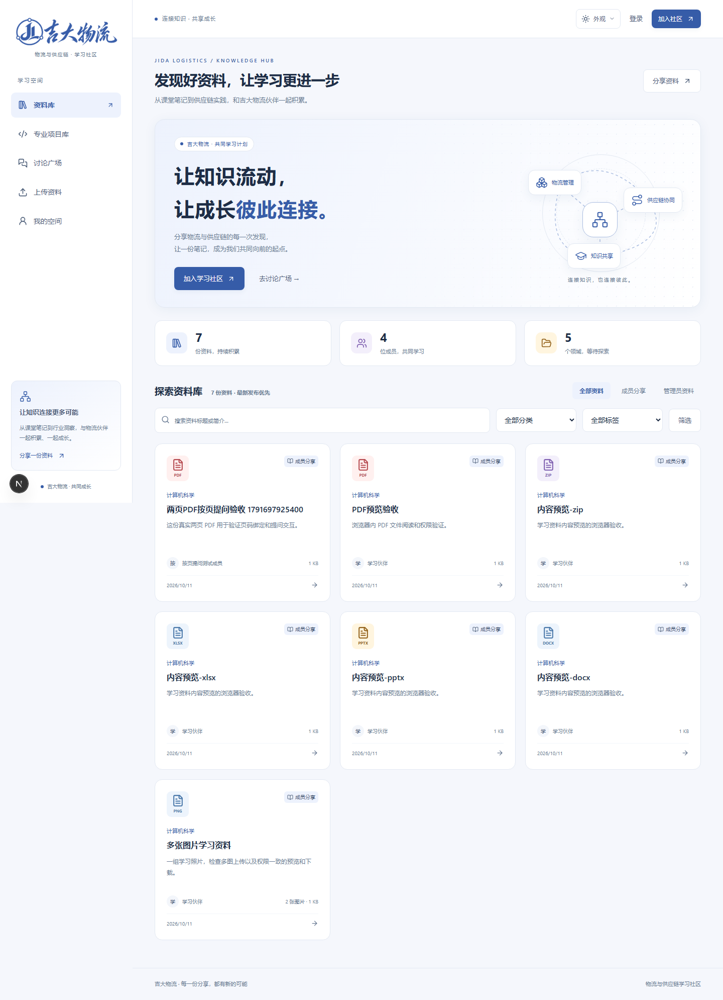

# 知页 · 吉大物流

面向**物流管理与计算机科学与技术双学位**的学习社区，将课程资料、专业项目和学习讨论放在同一个网站中。资料与项目介绍公开，预览、下载和讨论向审批通过的成员开放。

中文界面，支持电脑与手机、浅色与暗色主题。采用一个 Next.js 项目同时提供页面与服务端，适合小型社区在单台服务器上运行。

<details>
<summary>查看界面截图（隔离测试数据）</summary>

浅色桌面资料库：



其他外观：[暗色桌面](docs/design/ui-v1/jida-home-dark-desktop.png)、[浅色手机](docs/design/ui-v1/jida-home-light-mobile.png)、[暗色手机](docs/design/ui-v1/jida-home-dark-mobile.png)。

</details>

## 功能

- **资料库**：成员分享区与管理员资料区，分类、标签、关键词搜索和分页；文档或多图发布，授权预览与下载。
- **内容预览**：图片、PDF、纯文本、现代 Office 文档内容及 ZIP 文件目录。PDF 支持翻页、缩放和本页文字。
- **学习交流**：独立讨论区、资料评论、图片与两层回复；PDF 问题绑定具体文件和页码，支持跳页、已解决与重新打开。
- **专业项目库**：课程与技术标签筛选、ZIP 发布、README / 代码浏览、历史版本下载、图文讨论和同步失败重试。
- **GitHub 项目存储**：每个项目保存在专用组织的私有仓库；网站代理成员访问，同学无需 GitHub 账号。项目同步由独立后台进程执行。
- **成员与管理**：邮箱验证、入会审批、重新申请、密码重置；管理员内容管理与操作记录，超级管理员邀请和管理管理员。

## 权限与容量

| 身份              | 公开资料与项目介绍 | 预览、下载与讨论 | 成员区上传与项目发布 | 管理员区上传及内容管理 | 管理管理员 |
| ----------------- | ------------------ | ---------------- | -------------------- | ---------------------- | ---------- |
| 访客 / 待审批用户 | ✓                  | —                | —                    | —                      | —          |
| 成员              | ✓                  | ✓                | ✓                    | —                      | —          |
| 管理员            | ✓                  | ✓                | ✓                    | ✓                      | —          |
| 超级管理员        | ✓                  | ✓                | ✓                    | ✓                      | ✓          |

成员权限需要有效会话、已验证邮箱、`ACTIVE` 状态，以及完成初始密码修改。邮箱验证和管理员审批是独立步骤；管理员身份也需要满足账号可用条件。普通管理员不能修改其他管理员或超级管理员的权限。

- 资料：一份文档 / ZIP，或最多 20 张图片；每次发布总量不超过 **50 MiB**。
- 帖子、评论与回复：每条最多 20 张图片，总量不超过 **50 MiB**。
- 项目：ZIP 实际大小与全部实际解压内容分别不超过 **200 MiB**，单文件不超过 **100 MiB**，最多 1000 个条目（包含显式目录）。依赖、编译产物、密码配置、密钥与自动执行的工作流不会导入。
- 文件和内部内容由服务端逐次授权。上传文件保存在私有目录，项目代码只供阅读与下载，不在线运行。

完整规则见 [需求与权限矩阵](docs/requirements.md)。文档中的 50MB / 200MB 限额按 `50 / 200 × 1024 × 1024` 字节执行。

## 技术栈

| 部分         | 方案                                        |
| ------------ | ------------------------------------------- |
| 页面与服务端 | Next.js 16 App Router、React 19、TypeScript |
| 界面         | Tailwind CSS 4、Radix UI、shadcn 风格组件   |
| 认证         | Better Auth、数据库会话                     |
| 数据库       | Prisma 7、SQLite、better-sqlite3            |
| 文件与项目   | 本地私有存储、流式上传、GitHub App          |
| 邮件         | Nodemailer；开发环境使用 Mailpit            |
| 校验与测试   | Zod、Vitest、Playwright                     |

依赖版本由 `package-lock.json` 固定，使用 `npm ci` 安装。

## 环境与快速启动

需要 **Node.js 24、npm**。支持 Windows 本地开发；Linux 生产环境采用单实例和持久化磁盘。进入源码目录后执行：

```shell
npm ci
npm run setup
```

`setup` 会在没有 `.env` 时创建本地配置、随机认证密钥与初始密码，生成 Prisma 客户端、应用迁移并初始化分类。重复运行不会重置已有账号。初始超级管理员配置保存在本机 `.env` 的 `INITIAL_ADMIN_EMAIL` / `INITIAL_ADMIN_PASSWORD`，首次登录必须修改密码。

### 开发邮件

Windows 可使用安装脚本获取 Mailpit：

```powershell
powershell -NoProfile -ExecutionPolicy Bypass -File scripts/install-mailpit.ps1
npm run mail
```

Linux 开发环境可将 Mailpit 可执行文件放到 `.tools/mailpit` 后运行 `npm run mail`。也可以在本地 `.env` 配置已有 SMTP 服务。

保持邮件终端运行，在另一个终端启动网站：

```shell
npm run dev
```

- 网站：<http://127.0.0.1:3000>
- 开发收件箱：<http://127.0.0.1:8025>

默认开发邮件只进入 Mailpit，不发送到真实邮箱。注册验证、管理员激活和找回密码都需要邮件服务。

### 可选：连接专业项目库

未配置 GitHub 时，账号、资料、预览、讨论和 PDF 提问仍可使用，项目上传会显示未连接提示。

需要实际发布项目时，按 [GitHub 配置说明](docs/github-setup.md) 创建专用组织、注册并安装 GitHub App，在服务器配置组织名、App ID、Installation ID 和私钥路径；然后单独运行同步进程：

```shell
npm run projects:worker
```

上传请求保存任务，后台进程同步到私有仓库并确认版本后清理临时文件。文件较多时同步需要时间，可以从“我的项目”查看状态。

## 配置

全部变量与示例见 [`.env.example`](.env.example)，配置说明见 [运行与备份文档](docs/operations.md)。

| 配置                                                                                        | 用途                         |
| ------------------------------------------------------------------------------------------- | ---------------------------- |
| `DATABASE_URL`、`STORAGE_DIR`                                                               | SQLite 与私有资料文件位置    |
| `BETTER_AUTH_URL`、`BETTER_AUTH_SECRET`                                                     | 网站地址与认证密钥           |
| `SMTP_*`、`MAIL_FROM`                                                                       | 邮件服务与发件人             |
| `INITIAL_ADMIN_EMAIL`、`INITIAL_ADMIN_PASSWORD`                                             | 第一次创建超级管理员         |
| `PROJECT_TEMP_DIR`                                                                          | 私有项目暂存目录             |
| `GITHUB_ORGANIZATION`、`GITHUB_APP_ID`、`GITHUB_INSTALLATION_ID`、`GITHUB_PRIVATE_KEY_PATH` | GitHub 项目存储授权          |
| `BACKUP_APP_URL`                                                                            | 备份时检查的本地网站监听地址 |

生产数据库、文件和项目暂存目录应在代码目录外持久化。`.env`、数据库、用户文件、备份和 GitHub 私钥不应提交到仓库。

## 开发与验证

```shell
npx next typegen
npm run typecheck
npm test
npx playwright install chromium
npm run test:e2e
npm run build
```

首次在干净目录运行类型检查前，先生成 Next.js 类型；开发或构建也会生成相应文件。

端到端测试需要 Mailpit 运行，使用独立的 `data/e2e` 数据库、私有文件、项目暂存目录和 3100 端口，不修改正常社区数据。项目测试使用本机 GitHub 模拟器与临时测试密钥，不操作真实组织。

截至 **2026-10-12**，用户已确认正式站点的 GitHub 同步、小项目和约 60MB 项目上传、下载成功，Nginx 项目上传配置已检查并重新加载。PDF 按页提问已通过本地浏览器测试，线上人工验收尚未收到确认；200 MiB 极值及生产压力测试也不在上述实测范围内。详细验证记录见 [任务与验收清单](docs/tasks.md)。

## 目录结构

```text
src/
├─ app/           页面、Server Actions 与 Route Handlers
├─ components/    布局、表单、资料 / 项目、PDF 阅读与讨论组件
├─ services/      账号审批、内容、权限、项目同步与存储业务
└─ lib/           认证、数据库、校验、邮件与通用工具
prisma/           数据模型与版本化迁移
scripts/          初始化、邮件、项目 worker、备份、测试与发布工具
tests/            权限、业务、存储与浏览器验收测试
docs/             需求、架构、部署与备份文档
public/           网站静态资源，不存放用户上传文件
.env.example      环境变量模板
```

页面与组件 → 服务端入口 → 业务服务与权限 → 数据库、文件、邮件与 GitHub。详见 [架构说明](docs/architecture.md)。

## 部署与备份

生产运行使用 `npm run build`、`npm start` 和独立的项目 worker，前方配置反向代理与 HTTPS。普通资料与项目上传的代理限额分别配置；项目上传需要较大的请求体限额、超时和私有临时磁盘空间。

- [配置、生产运行与一致性备份恢复](docs/operations.md)
- [邮件认证排查与服务器账号恢复](docs/account-recovery.md)
- [GitHub 组织与 App 接入](docs/github-setup.md)
- [已有站点升级项目库与 PDF 提问](docs/upgrade-projects.md)
- [成员使用本次功能](docs/next-update.md)

本地备份包含数据库、私有资料与待同步项目包；**已发布的 GitHub 项目源码需要独立备份**，不能用数据库副本替代远端仓库历史。

当前采用 SQLite 与本地私有文件，不支持无持久化磁盘的 Serverless 或多实例部署。Office 提供正文、表格及幻灯片文字预览，不保证原始排版；旧版 Office 文件主要提供下载。暂不包含即时聊天、视频上传、在线运行代码、付费、积分或全文索引。

## 参与开发

开始前阅读 [贡献指南](CONTRIBUTING.md)、[需求](docs/requirements.md)、[架构](docs/architecture.md) 和 [项目约束](AGENTS.md)。新增功能或改变权限时，同步更新规则与验收测试。

将网站源码发布到 GitHub 的步骤见 [源码仓库发布说明](docs/github-source.md)。运行 `npm run package:github` 可生成仅含可分享源码的 ZIP；网站内成员资料和私有项目不随源码发布。

## 许可证

项目使用 [MIT License](LICENSE)。网站成员上传的课程资料、图片和专业项目内容各自的权利归属，不因本网站源代码采用 MIT 而改变。
